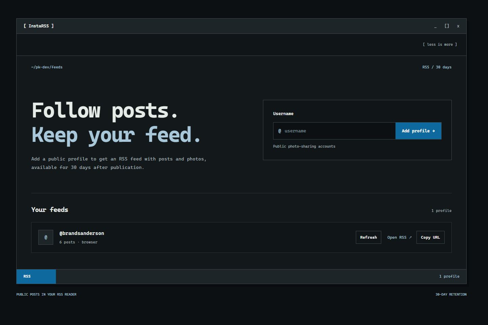

# InstaRSS

Turn public photo-sharing profiles into RSS feeds with images.



InstaRSS is a self-hosted application for following public profiles in your RSS reader. Each entry includes the post text, a link to the original post, and locally stored images. Posts and images are retained for **30 days from publication**.

## Features

- Add public profiles through the web interface.
- Open or copy a feed URL for each profile.
- Fetch through the official API first, with public HTML and browser-rendered pages as fallbacks.
- Serve images from the application instead of relying on temporary source URLs.
- Remove expired posts and image files during full synchronization.
- Protect the management interface with an optional administrator password while keeping feeds and images public.
- Trigger full synchronization through a token-protected HTTP endpoint, suitable for an external cron job.
- Use a terminal-inspired dark interface with monospace typography and blue accents.

## Stack

Next.js App Router, React, TypeScript, SQLite, Drizzle ORM, Cheerio, and Playwright.

The application requires a Node.js server with a writable, persistent local disk. It is not a static site.

## Quick start

Requirements: Node.js 20 or newer, npm, and Chromium for the browser fallback.

```bash
npm ci
npx playwright install chromium
cp .env.example .env.local
npm run dev
```

On Windows PowerShell, replace the copy command with:

```powershell
Copy-Item .env.example .env.local
```

On Linux, install Chromium and its system dependencies when needed:

```bash
npx playwright install --with-deps chromium
```

Open [localhost:3000](http://localhost:3000), add a username, and click **Refresh** to fetch its available posts. Use **Open RSS** or **Copy URL** to subscribe in your reader.

A feed URL looks like this:

```text
http://localhost:3000/rss/example_profile.xml
```

A localhost URL is only accessible on the machine running the application. For other devices or hosted RSS readers, deploy the application under a reachable URL and set `APP_BASE_URL` accordingly.

## Configuration

Use `.env.local` for local development and service environment variables in production. Both the web application and CLI synchronization scripts load the local environment configuration.

| Variable | Default | Purpose |
| --- | --- | --- |
| `DATA_DIR` | `./data` | Directory containing the SQLite database and downloaded images. Use a persistent local volume in production. |
| `APP_BASE_URL` | Local example: `http://localhost:3000` | Public application URL used for image links in RSS and copied feed URLs. Set this to your deployed URL. |
| `ADMIN_PASSWORD` | Empty | Enables HTTP Basic authentication for the management interface and profile actions. The username is `admin`. |
| `SYNC_TOKEN` | Empty | Separate Bearer token for `POST /api/sync`. The endpoint is disabled when this is empty. |
| `META_ACCESS_TOKEN` | Empty | Optional access token for the official API. |
| `META_IG_USER_ID` | Empty | Professional account identifier used by Business Discovery. Required alongside the API token. |
| `META_GRAPH_VERSION` | `v24.0` | Graph API version used by the API adapter. |

Without API credentials, the application attempts the public-page fallbacks. API credentials must have the permissions and account access required by the provider.

Set `ADMIN_PASSWORD` before exposing the management interface publicly. Use HTTPS when deploying with authentication. Keep `.env.local`, tokens, passwords, database files, and downloaded images out of version control.

## Synchronization

Automatic scheduling is not enabled by default. There are three ways to fetch posts:

| Method | Scope |
| --- | --- |
| **Refresh** in the interface | Fetches one profile. |
| `npm run sync` | Removes expired data, then fetches every configured profile. |
| `POST /api/sync` | Runs the same full synchronization remotely. |

Run cleanup independently with:

```bash
npm run cleanup
```

The full synchronization endpoint uses its own token, independently of administrator authentication:

```bash
curl --fail-with-body --request POST \
  --header "Authorization: Bearer $SYNC_TOKEN" \
  "$APP_BASE_URL/api/sync"
```

Export `SYNC_TOKEN` and `APP_BASE_URL` into the calling shell before using this example; curl does not load `.env.local`. Use `curl.exe` when invoking curl from Windows PowerShell.

| HTTP status | Meaning |
| --- | --- |
| `200` | Synchronization completed successfully. |
| `401` | Missing or incorrect Bearer token. |
| `409` | Another full synchronization is running. |
| `502` | One or more profiles or their images could not be fetched or saved. Check the JSON results. |
| `503` | The endpoint is disabled because `SYNC_TOKEN` is unset. |
| `500` | Synchronization could not complete because of an internal error. |

Full synchronization uses a database lock with a renewable lease to prevent overlapping full runs. A failed profile does not discard previously imported posts.

## Retention and images

Retention is measured from the source post's publication timestamp, not its import time. Posts older than 30 days are skipped during import.

Expired entries are excluded from RSS and their image endpoints stop serving them. Physical deletion happens during the next full synchronization or standalone cleanup: image files are removed, then the post and associated image records are deleted from SQLite. The profile remains available for future updates.

For a successfully running hourly schedule, physical deletion normally occurs within an hour of expiry. Images referenced by old entries cached in an RSS reader will stop loading after retention expires.

## Deploying on Railway

Run the web application as a persistent service:

1. Install dependencies and build with `npm ci && npm run build`.
2. Install Chromium and its Linux dependencies in the deployment image so the browser fallback can run. There is currently no bundled Dockerfile; configure this as part of your image or build setup.
3. Start the application with `npm run start`.
4. Attach a persistent volume, for example at `/data`, and set `DATA_DIR=/data`.
5. Set `APP_BASE_URL` to the service's HTTPS URL and configure `ADMIN_PASSWORD` and `SYNC_TOKEN`.

Keep the web application and its SQLite database on a single service instance. SQLite WAL access requires the processes using the database to share the same host; a separate cron service does not share the application's local files.

For hourly updates, create a separate Railway cron service that sends an HTTP request to the application. Configure these variables on the cron service:

- `APP_BASE_URL`: the deployed application's URL.
- `SYNC_TOKEN`: the same synchronization token configured on the application service.

Use an image containing curl and a shell, and set its start command to:

```sh
sh -c 'curl --fail-with-body --request POST --header "Authorization: Bearer $SYNC_TOKEN" "$APP_BASE_URL/api/sync"'
```

Set the cron schedule to `0 * * * *` for hourly execution. Railway cron schedules use UTC. The cron process waits for the HTTP request to finish and then exits; allow enough request time for all profiles to be processed. Synchronization runs inside the application service, where the database and images are stored.

## Fetching limitations

Public-page access depends on what the source platform makes available without signing in. A login prompt, request limit, or markup change can prevent imports. Browser rendering is a fallback, not a guarantee of access.

The current implementation processes up to 30 posts returned by the API or discovered on the public page. Browser fetching uses the currently rendered post links and does not scroll through the full profile history. A feed may therefore contain fewer posts than were published within the retention period.

The API adapter can include multiple images from a carousel. The scraping fallbacks currently capture one preview image per post. Videos are represented by a preview image when one is available; video files are not downloaded.

Use the application only for content you are authorized to fetch and redistribute, in accordance with the source provider's terms.

## Development checks

```bash
npm run check
npm run build
npm run test:smoke
npx tsx scripts/sync-endpoint-smoke.ts
```

The smoke checks use separate local test databases. Live provider access is not required for these checks.

See [AGENTS.md](AGENTS.md) for contribution workflow, code conventions, and data-handling requirements.
