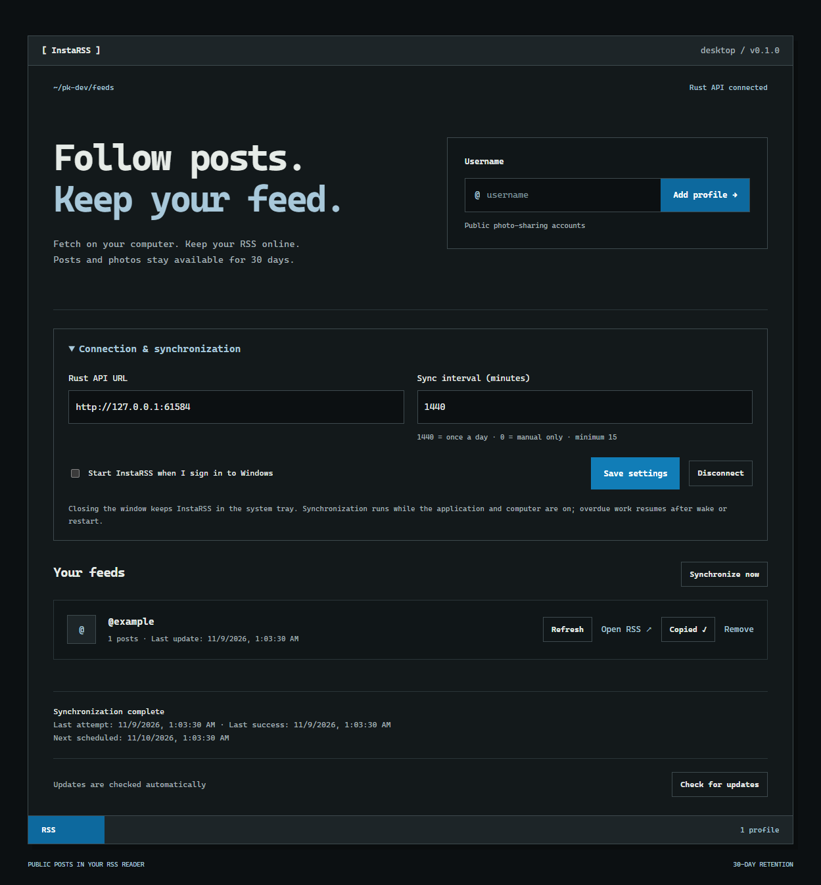

# InstaRSS

Turn public photo-sharing profiles into RSS feeds with images.

InstaRSS combines a **Windows desktop application** with a **Rust API**. The desktop fetches posts using the computer's connection; the API stores them in SQLite, serves their images, and keeps RSS available even when the desktop is closed. Posts and photos expire **30 days after publication**.



## How it works

```text
Electron desktop → HTTPS Rust API → SQLite + image files
                         ↓
                  Public RSS readers
```

- Add and remove profiles from the desktop.
- Set synchronization frequency in minutes, or use manual-only mode. The default is once a day.
- Run synchronization immediately for one profile or all profiles.
- Keep synchronization running in the Windows system tray; optionally enable startup at sign-in.
- Catch up after sleep or the next application start. A powered-off computer cannot fetch posts.
- Copy the public RSS URL from the configured Rust API, not a localhost feed.
- Download updates automatically and restart to install them through Velopack.

## Windows application

Download the installer from [GitHub Releases](https://github.com/pk-dev-cs/InstaRSS/releases). Install it, open **Connection & synchronization**, and enter:

1. The Rust API's HTTPS URL.
2. The administrator password configured on that server.
3. Your preferred sync interval: `1440` minutes is once a day; `0` disables automatic synchronization.

The password is used once to issue a revocable installation token. It is not stored. The desktop stores its token using Electron's operating-system-backed encrypted storage. The server stores only a hash of each token. This is a single-owner application: authorized installations manage the same profiles and feeds.

Closing the window hides it in the tray. Choose **Quit** in the tray menu to stop the application. Synchronization requires an internet connection and a running application; it does not wake a powered-off computer.

### Run from source

Requirements: Node.js 22.12 or newer and npm.

```bash
npm ci --prefix desktop
npm --prefix desktop run dev
```

The desktop uses Electron's Chromium for public-page fetching. It does not require a separate Playwright browser installation.

## Rust API

Requirements: a current stable Rust toolchain, a writable local disk, and SQLite build prerequisites for your platform.

```bash
cargo test --manifest-path api/Cargo.toml --locked
cargo run --manifest-path api/Cargo.toml
```

Set environment variables before starting the process. Rust does not automatically load `.env.local`. See [api/.env.example](api/.env.example).

| Variable | Purpose |
| --- | --- |
| `DATA_DIR` | Persistent directory for `feed.sqlite` and `media/`; defaults to `./data`. |
| `APP_BASE_URL` | Public URL used in RSS image links; defaults to `http://localhost:3000`. |
| `ADMIN_PASSWORD` | Required to connect new desktop installations. With no password, pairing is disabled. |
| `PORT` | HTTP listening port; defaults to `3000`. |
| `API_TOKEN` | Optional maintenance Bearer token. Leave empty if only installation tokens are needed. |
| `SYNC_TOKEN` | Compatibility fallback when `API_TOKEN` is unset; supports an existing Railway cleanup cron. |

The API checks expiry when serving RSS and images. An internal hourly job physically removes expired posts and files, even if no desktop is running. `POST /api/cleanup` can also trigger cleanup. In the Rust API, the compatibility endpoint `POST /api/sync` performs **cleanup only**; fetching is a desktop responsibility.

### Public URLs

```text
https://your-api.example/rss/example_profile.xml
https://your-api.example/media/123
```

RSS and retained images are public. They remain available while the desktop is off. New entries appear after a successful desktop synchronization.

### API endpoints

| Method | Path | Access |
| --- | --- | --- |
| GET | `/api/health` | Public database health check. |
| POST | `/api/devices` | Basic authentication as `admin`; returns an installation token. |
| DELETE | `/api/devices/{id}` | Bearer token; revokes an installation. |
| GET, POST | `/api/profiles` | Bearer token; list or add profiles. |
| DELETE | `/api/profiles/{username}` | Bearer token; removes the profile, posts, and files. |
| POST | `/api/profiles/{username}/posts` | Bearer token; imports a post with image data. |
| POST | `/api/profiles/{username}/status` | Bearer token; reports a synchronization result. |
| POST | `/api/cleanup` | Bearer token; runs retention cleanup. |
| GET | `/rss/{username}.xml` | Public RSS with image enclosures and Media RSS metadata. |
| GET | `/media/{id}` | Public image until the post expires. |

Post uploads include the source ID, caption, permalink, publication timestamp in milliseconds, and image bytes encoded as Base64. The API validates image signatures and types, limits upload sizes, skips expired posts, and deduplicates imports. A post accepts up to 10 images, 10 MB per image, and 20 MB combined decoded image data. The desktop scraper currently imports one preview image per post.

## Railway deployment

Build the new API with **`api/Dockerfile`**, using the repository root as the build context:

```bash
docker build -f api/Dockerfile -t instarss-api .
```

Configure the Railway service as follows:

- Dockerfile path: `api/Dockerfile`.
- Persistent volume mounted at `/data`, with `DATA_DIR=/data`.
- `APP_BASE_URL` set to the service's public HTTPS URL.
- `ADMIN_PASSWORD` set to your chosen password.
- Healthcheck path: `/api/health`.
- One replica on the same host as the SQLite volume.

The new API reads the existing `feed.sqlite` and `media/` layout. Its migration preserves existing profiles, posts, image IDs, and RSS item identifiers. Before switching a live service, keep a volume backup and stop the old application before starting the replacement against that volume.

## Versioned installers and automatic updates

The [desktop release workflow](.github/workflows/desktop-release.yml) runs when a stable version tag is pushed, for example:

```bash
git tag v0.1.0
git push origin v0.1.0
```

The workflow validates the tag, sets the desktop package version, runs checks, packages Windows x64 with Electron, and uses **Velopack 1.2.161** to publish the installer and update feed to a GitHub Release. It uses the repository's built-in Actions token with `contents: write`; no GitHub token is embedded in the desktop application.

Installed applications check the public release feed at startup and every six hours. Updates download in the background; **Restart & update** installs the downloaded version. Application settings live outside the installation directory and survive updates.

Installers are currently unsigned because no code-signing certificate has been configured. Windows may display an unknown-publisher warning. End-to-end installation of a future version through a published release requires at least two released versions; local builds do not prove that production update path.

### Package locally

```bash
npm --prefix desktop run package
dotnet tool install --tool-path .tools vpk --version 1.2.161
.tools/vpk pack -u InstaRSS -v 0.1.0 -p desktop/out/InstaRSS-win32-x64 -e InstaRSS.exe --runtime win-x64 --icon desktop/assets/icon.ico -o desktop/Releases
```

Use `.tools/vpk.exe` on Windows. The .NET SDK is needed by the packaging tool, not by the installed Electron application.

## Development checks

```bash
npm --prefix desktop run check
npm --prefix desktop test
cargo fmt --manifest-path api/Cargo.toml -- --check
cargo test --manifest-path api/Cargo.toml --locked
cargo build --manifest-path api/Cargo.toml --locked
npm --prefix desktop run test:e2e
```

The integration test launches the actual Electron application and a separate local Rust API using temporary test data. It supplies controlled public-page and image responses, then verifies ingestion, public RSS and image access, Copy URL, settings persistence, the daily interval, and close-to-tray behavior. It does not require live source access.

## Source availability

Fetching from the user's computer changes the connection seen by the source provider. It does not guarantee public access. The source may still require sign-in, limit requests, or change its markup. The current desktop fetcher does not store a source login session or bypass access restrictions. It reports failures while preserving previously imported posts.

Currently, fetching processes up to 30 discovered post links without scrolling the entire profile. The feed may contain fewer posts than were published during the retention period. Video files are not downloaded; an available preview image represents a video post.

Fetch and redistribute only content you are authorized to use, under the source provider's terms.

## Migration status

The original Next.js application remains in `app/`, `lib/`, and the root npm configuration so a working web deployment can be retained during the transition. The root `Dockerfile` still builds that version. See [the legacy web documentation](docs/legacy-web.md) for its commands. The new applications have independent dependencies in `desktop/` and `api/`.

See [AGENTS.md](AGENTS.md) for contribution rules.
